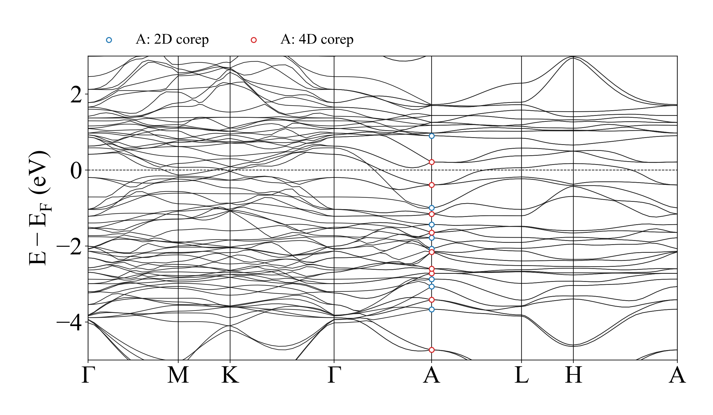

# Mn3Sn: from spinor WAVECAR coefficients to SSG labels

This example connects the numerical SSGReps solver to actual noncollinear,
SOC-free VASP wavefunctions for **SSG 194.1.6.1.P**. It is restricted to the
validated Mn3Sn cell, origin convention, coplanar texture, and spin frame.
The reusable coefficient and character routines live in
[ssg_wavecar.py](../../SSGReps/ssg_wavecar.py); the external binary reader remains
an optional dependency.

**Measured result:** 530/582 band blocks passed at 14 distinct k points; 52
remain `UNRESOLVED`. Including a separate 60/60 repeat at a general point gives
590/642 accepted blocks in 15 evaluations. The code preserves failed decisions
and diagnostics. This is not a claim that all bands have reliable labels.

## Inspect or recheck the bundled results

- [Material validation report and all tested points](results/README.md)
- [A-point unitary character table, 19 band assignments, and 4D matrices](results/A_point.md)
- [Probe report](results/analysis_probe/report.txt) and [line report](results/analysis_bands/report.txt)
- [Numerical energies](results/band_energies.csv), [probe labels](results/analysis_probe/band_labels.csv), and [line labels](results/analysis_bands/band_labels.csv)
- [Calculation provenance](results/provenance.json), [software/convergence record](results/execution_validation.json), and [band-count control](results/band_count_convergence.json)



From the repository root, with the standard requirements installed:

```bash
python examples/wavecar_mn3sn/replay_validation.py
python -m unittest discover -s tests -p 'test_wavecar.py'
```

The replay reads saved full-precision unitary matrices and recomputes traces,
unitarity, all unitary products, multiplicities, reconstruction residuals, and
accept/reject decisions. It also rejects an intentionally incomplete two-state
subset of the measured four-dimensional A-point block. It needs neither VASP,
MOM2SSG, nor a WAVECAR reader. Leakage comes from the saved coefficient analysis;
recomputing leakage requires the original WAVECAR. Replay success means the
recorded decisions are reproduced, including all 52 unresolved blocks.

## Rerun the material adapter on actual WAVECAR files

Install the main repository requirements first. Identification additionally uses
`MOM2SSG`; file parsing uses `vaspwfc.py` from
[VaspBandUnfolding](https://github.com/QijingZheng/VaspBandUnfolding), including
its companion modules. Supply its checkout with `--reader`. Matplotlib is only
needed for plotting. The original run used MOM2SSG package metadata version
1.0.0 and Matplotlib 3.10.0 on Python 3.12; full versions and the reader file hash
are recorded in `results/execution_validation.json`. The reader is not vendored.
The local regression suite uses the pinned core requirements on Python 3.9.

Use a writable run directory with this layout:

```text
mn3sn_run/
  provenance.json                 # Source SCF Fermi energy and path metadata.
  probe/INCAR, POSCAR, WAVECAR     # Seven directly calculated probe points.
  bands/INCAR, POSCAR, WAVECAR     # 106 path points plus one general point.
  symmetry/                       # Written by align_spin_basis.py.
```

The bundled `results/` contains input files and provenance for the recorded run;
copy it to a separate directory before restoring the corresponding WAVECAR
files or generating new output. Update provenance for a different calculation.
The same-stage INCAR and POSCAR must describe the WAVECAR being read. Licensed
POTCARs, VASP binaries, CHGCARs, and large WAVECARs are not distributed.

```bash
python examples/wavecar_mn3sn/align_spin_basis.py --run /path/to/mn3sn_run
python examples/wavecar_mn3sn/analyze_wavecar.py \
  --run /path/to/mn3sn_run --reader /path/to/VaspBandUnfolding --stage probe
python examples/wavecar_mn3sn/analyze_wavecar.py \
  --run /path/to/mn3sn_run --reader /path/to/VaspBandUnfolding --stage bands \
  --kpoints 8 23 38 53 68 83 98 107
```

`align_spin_basis.py` identifies the group, matches its spatial representatives,
fits a common proper spin rotation and its SU(2) lift, and checks positions and
magnetic moments. The recorded mapping is `O = diag(1,-1,-1)`, with identity
spatial cell mapping and zero origin shift. New mappings record a POSCAR hash;
the analyzer also checks the WAVECAR lattice, NSOC settings, and `SAXIS=(0,0,1)`.
These checks do not infer the symmetry of an arbitrary converged Hamiltonian.

`analyze_wavecar.py` constructs the **full theoretical corepresentations**, but
extracts and matches **only unitary wavefunction matrices and characters**.
The reader flag `lsorbit=True` selects its two-component spinor file layout;
the physical VASP calculation still has `LSORBIT=F` and `LNONCOLLINEAR=T`.
The code uses the reader's own G ordering and unnormalized coefficients.

| Option | Default | Meaning |
| --- | --- | --- |
| `--stage` | `probe` | Select `probe/WAVECAR` or `bands/WAVECAR` |
| `--kpoints` | All file indices | One-based indices; duplicate/out-of-range indices are rejected |
| `--last-band` | 60 | Upper analysis boundary; blocks crossing it are omitted in full |
| `--gap` | 0.002 eV | Adjacent-energy gap defining candidate blocks |
| `--character-tol` | 0.002 | Absolute character and multiplicity tolerance |
| `--leakage-tol` | 0.005 | Maximum relative norm outside the selected subspace |
| `--matrix-tol` | 0.002 | Frobenius tolerance for unitarity and all unitary products |
| `--output` | `RUN/analysis_STAGE` | Destination for text, CSV, JSON, and per-k NPZ matrices |
| `--require-all` | Off | Exit with code 2 after writing reports if any block is unresolved |

Candidate grouping is not proof of a degeneracy. All four acceptance checks
must pass. The last WAVECAR band is excluded from selection because the next
state is unavailable to determine whether its multiplet is complete. JSON
records `all_blocks_passed`; a normal report-generation exit alone is not a
scientific all-pass result. Labels `r1`, `r2`, etc. are local to a k point, factor
system, and spin-lift convention, not band-connectivity labels.

For plotting an actual run, add `--reader /path/to/VaspBandUnfolding`. To plot the
cached energies without it:

```bash
python examples/wavecar_mn3sn/plot_bands.py \
  --run examples/wavecar_mn3sn/results --cached --output mn3sn_plot
```

The portable plot defaults to DejaVu Serif. To reproduce the recorded Times New
Roman styling, pass `--font-family "Times New Roman"` and, if needed,
`--font-dir /path/to/fonts`. Fonts are not distributed. The general point is
excluded from the connected path. A-point markers show accepted dimensions;
they do not extend assignments to untested path points.

## Mathematical choices and physical limits

The forward action is `V_g psi(R_g^-1 (x-tau_g))`. For reciprocal rows,
`q' = (G+k) R_g^-1` and the coefficient phase is `exp(-2*pi*i*q'·tau_g)`.
A common Gram basis `Q=C(C^dagger C)^(-1/2)` gives `B_g=Q^dagger g(Q)`.
This fixes the inverse-operation ambiguity and the incorrect assumption that
individually normalized PAW pseudo-states form an orthonormal set.

Matching uses every unitary operation with full numerical precision. Each
corepresentation character is divided by its actual squared restriction norm;
normalized norms 1, 4, and 2 correspond to Wigner indicators +1, -1, and 0.
Antiunitary matrix-part traces never enter character tables or matching.
Antiunitary operations remain necessary to build and validate the theoretical
corepresentations. See the [full derivation](../../docs/usage.md#comparison-with-vasp-wavefunctions).

The Gram transformation represents the action on a pseudo-state subspace. It
does not compute all-electron PAW overlaps or spin observables. Equivalence to
the physical representation assumes an injective, symmetry-equivariant PAW map
and a complete multiplet of the actual full Hamiltonian symmetry. Unitary
matching by itself does not independently establish that physical assumption.

The final data use an independently converged historical NSOC density. A new
tighter full-SSG SCF trial did not converge and is explicitly excluded. Raising
NBANDS from 64 to 96 improved some labels but left 52 unresolved blocks. Saved
real-space density covariance does not check complex PAW augmentation matrices;
the current records do not isolate a unique cause of the remaining failures.
SOC, arbitrary material/cell mappings, automated band connectivity, and universal
exact symbolic WAVECAR matrices are outside this example's validated scope.

The source-density calculation used a custom VASP build with `LSSG` and
`L_ANTIUNI`; these are not standard VASP settings. They are false in the final
fixed-density band inputs. The archived INCAR files document the actual run,
not a claim that a standard VASP installation can reproduce the custom SCF.

## Provenance of the integration

`results/` preserves the original measured matrices, labels, inputs, controls,
and execution records. Its report navigation was updated for this repository.
The historical source-release hash in `execution_validation.json` identifies
the code used for the VASP analysis, not the newly packaged source archive.
The reusable kernel and portable adapters were subsequently integrated here;
the offline regression suite verifies that their matrix decisions reproduce
the recorded run. Scheduler-specific launchers and the old hard-coded summary
generator are replaced by portable CLI entry points and the replay script.
